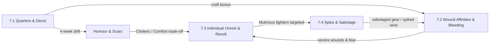

# Blood and Circus v7 Roadmap — Flesh, Temper, Unrest & Shadows

The designer's plan for 7.1–7.4 (received 2026-11-23), with review notes at the end. Each phase ships on its own and must
pass `npm run check` first.

- **Player-facing spelling and terms:** British spelling throughout (*Favour*, *Armour*, *Humour*, *Colour*); arena terms
  *Capitulate*, *All In* and *Death Gate*.
- **Story and card copy:** new event cards, sabotage reports and revolt scenes are marked `PLACEHOLDER` and indexed with
  `npm run text-index` for the designer's rewrite.

## 1. Vision

7.0.0 made Seasons taut and readable, but life in the Ludus between fight days is mostly arithmetic: quarters only pad
Comfort and Stress, Humours are fixed at recruitment, injuries roll on one flat d100 curve, Revolt is a 4-week house-average
cliff that rarely fires, and spies are a one-off card. 7.1–7.4 make how you house, arm and treat your gladiators shape who
they become, and how they push back.

## 2. Phases

| Phase | Version | Theme | Main modules |
| :--- | :---: | :--- | :--- |
| 0.5 | 7.0.1 | Fast balance harness | `src/run/tournaments.js`, `src/fight.js`, `scripts/checks.js` |
| 1 | 7.1.0 | Living quarters and Humour shaping | `src/data.js`, `src/run/roster.js`, `src/run/weekly.js`, `src/ui/views.js` |
| 2 | 7.2.0 | Targeted injuries, Bleeding and affinities | `src/data.js`, `src/fight.js`, `src/narrate.js`, `src/odds.js` |
| 3 | 7.3.0 | Individual unrest, contagion and revolt | `src/run/weekly.js`, `src/run/eventsEngine.js`, `src/events.js` |
| 4 | 7.4.0 | Spies, double agents and rival sabotage | `src/run/espionage.js` (new, L3d), `src/run/houses.js`, `src/run/tournaments.js` |

### Phase 0.5 (7.0.1): fast balance harness — done
Memoise `betOdds` per match; a `fast: true` match for `estimateOdds` (cheaper fighter copy, no `r.before` snapshot); run
`speedSplit` as one job per Boss. Done when the tests pass and the gates give bit-for-bit identical numbers, faster.

### Phase 1 (7.1.0): living quarters, decor and Humour shaping
Decor grows from 7 to 13 items, grouped in the UI as **Comfort**, **Temperament** and **Arena Craft**. Every decor button
states what it does for this fighter right now.

**Temperament drift (visible, not random):** `f.humourDrift = { to, weeks }`. `HUMOUR_DRIFT = { weeks: 4 }`. If a
fighter's room holds a dominant Temperament piece (more copies than any competing one) for a Humour they don't have,
`weeks` rises by 1 each week; at 4/4 their Humour converts, logged in the digest and chronicle ("Four weeks on the iron
slats have hardened Brutus: now Melancholic."). Tied Temperament pieces pause the drift ("Temperament tied").

| Item | Price | Comfort | Group | Effect |
| :--- | :---: | :---: | :---: | :--- |
| Rock Garden (`rockGarden`) | 3 | +5 | Temperament | −8 Stress a week; drifts to Phlegmatic. On a Rest week, meditates: −10 more Stress, +1 XP, and 1 step toward conquering Afeared. |
| Spiky Bed (`spikyBed`) | 2 | 0 | Temperament | No Comfort; drifts to Melancholic; +15% chance a Bloodied win grants Battle-Hardened. |
| Skull Rack (`skullRack`) | 3 | +3 | Temperament | Drifts to Choleric; severe wounds leave Enraged instead of Afeared; +1 unrest risk if Restless or Mutinous. |
| Wine Amphora (`wineAmphora`) | 3 | +7 | Temperament | Drifts to Sanguine; the fighter starts each match with +5 crowd Hype. |
| Viper Terrarium (`terrarium`) | 4 | +4 | Arena Craft | +20% Poison wound affinity (Phase 2); −5 Stress a week for Ash-Hungry and Vampire fighters. |
| Whetstone Rack (`whetstone`) | 4 | +4 | Arena Craft | +25% Bleed wound affinity (Phase 2) for bladed Fighters, Blood-Bearer and Thorn-Blade. |

The existing 7 items keep their stats.

### Phase 2 (7.2.0): targeted injuries, Bleeding and wound affinities
Keep the single escalating injury roll and the Death Gate (no hit-point bars); add a wound-affinity step in
`inflictInjury`.

- **Bleeding** (`bleeding`), weight 1, heals like a Flesh Wound. Bands: Flesh Wound 26–38, Bleeding 39–48, Concussed
  49–60; weight-2 bands 61–99 unchanged. "Counts as 1 injury. +10% chance to be injured (+5% while Guarding)." Triggers
  Bloodlust, Bloodthirsty and Blood Drinker; staunched for the match by a Blessed Bandage.
- **Body parts:** head (Distracted, Concussed, Senseless, Blinded), torso (Flesh Wound, Bleeding, Poisoned), limb (Maimed).
- **Affinity:** on a non-lethal roll, the attacker's affinities `{ tag, chance, upWeight }` may turn the rolled wound into
  their signature wound, only if `target.weight <= base.weight + upWeight`. Passive sources (weapon, gear, decor) have
  `upWeight: 0`: they steer, never add Death Gate weight. Single-use consumables have `upWeight: 1` on hits of 49+.
- **Consumables:** Viper Venom (3 Gold, reworked: +10% injure, 65% Poisoned affinity, `upWeight: 1` at 49+); Blood Thinner
  (3, new: +10% injure, 75% Bleeding affinity, `upWeight: 1` from Distracted at 18+); Blinding Powder (4, new: 60%
  Blinded on hits of 49+, else Distracted; countered by the Cyborg Eye); Blessed Bandage (3, buffed: −10% to be injured
  and suppresses one Bleeding wound for the match).
- **Passive affinities (35% steer, `upWeight: 0`):** Dagger, Serrated Spatha, Thorn-Blade, Blood-Bearer → Bleeding; Club,
  Cestus, War Maul → Concussed / Senseless; Axe, Executioner's Axe, Flail → Maimed; Bow, Hunter's Bow, Ornitharius → Blinded.
- **Counterplay:** the Cyborg Arm turns a second Maimed blow into a Flesh Wound (like the Cyborg Eye against Blinded).

### Phase 3 (7.3.0): individual unrest and revolt
Replace the 4-week average-Morale revolt with three rungs:

| Rung | Condition | Weekly effect |
| :--- | :--- | :--- |
| Agitation | Restless (20–39) and (Choleric, overtrained, or a Skull Rack) | Can't train; a bonded partner loses 3 Morale a week. |
| Defiance | Mutinous (< 20) | Refuses to fight; adds Unrest (+1, +1 if Choleric or a convict, +1 if Champion or level 4+); 25% weekly chance of an incident (brawl, theft or escape attempt, a rival's approach). |
| Uprising | `run.unrest >= 8` (cools 2 a week while nobody is Mutinous), after a warning week at 5+ | **The Chains Break** crisis. |

**The Chains Break** names the ringleader (the strongest Mutinous fighter) and offers: open the coffers (4 Gold × roster:
unrest 0, +15 Morale for 4 weeks); send in the guards (loyalists with Morale 50+ plus a garrison of 10 × House level
against mutineers under 30: put down = ringleader Concussed or Maimed, −6 Favour, unrest 2; overrun = the career ends,
"Killed in a gladiator revolt."); or, once a career with the plot at cause or ready, turn their fury on the Palatine
(trust and +15 Suspicion; the ringleader becomes the plot's champion).

### Phase 4 (7.4.0): spies and rival sabotage
New `src/run/espionage.js` with its own dice, `run.rng.espionage = createRng(deriveSeed(seed, 17))`.

- **Moles** come from a feuding house or high Palace Suspicion (40+) flipping a Mutinous fighter, or from one cheap recruit
  with origin clues. A mole never acts in their first week; first they leave 1–2 visible clues. Oracle Lv 2 or the
  Whispering Gallery narrows the suspects to two and unlocks "Investigate (2 Gold)". Unchecked: +1 Power to that house's
  opponents, +3 Suspicion a month, or Distracted / Overtrained on a bracket fighter before Round 1. Unmasked: execute
  (−15 Suspicion or −3 Glory to the rival, −5 Morale house-wide), turn (4 Gold or the Patron Lounge: +10% Round-1 win
  against that house until the feud ends), or ransom (+8 Gold, ends the feud).
- **Covert ops** (with a Liaison or Whispering Gallery, at most one a month): Steal the Playbook (3 Gold, 75%, +10% with
  the Gallery: exact Round-1 tactic and Boss debuff; failure gives the opponent Vengeance); Doctor the Wine (6 Gold, 60%,
  +15% with a double agent: the opponent arrives Overtrained or Bleeding; caught: −5 Favour and a 3-month feud); Bribe
  the Armourer (7 Gold, 60%: the opponent's armour gear is off for the bout; caught: −5 Favour, Gold lost).

## 3. Saves, replays and UI
- `SAVE_VERSION = 5` backfills `run.unrest = 0`, `run.espionage = { opMonth: null }`, `run.rng.espionage`, and turns
  `f.spy: true` into `{ master: 'palace', exposed: true }`.
- New actions (`investigate-spy`, `handle-spy`, `covert-op`) go through `applyGameAction` and into `scripts/play-text.js`.
- No new top-level tabs: decor groups fold inside the Fighter Quarters drawer; Unrest is a pill next to House Morale
  (detailed only above 0); covert ops live in the Scouting & Politics card.

## 4. New gates (on top of the 20)
1. Careful Season deaths 0.3–2.2, and first-career win rate 18–35%, after Bleeding and affinities.
2. No new decor item in more than 55% of winning careful houses.
3. Reckless careers have at least 3× the unrest incidents and crises of careful ones.
4. A career with no covert op and no mole has the same Market, Fortune and fight rolls as without espionage.

## 5. Open decisions
1. Ship 7.1.0–7.4.0 on `main`, or freeze 7.0.0 into `v7/` and call this arc v8?
2. Is a converted Humour permanent until reshaped, or does it revert when the decor goes? (Proposed: permanent.)
3. The Death-Gate guardrail for consumable affinities (`upWeight: 1` only on hits of 49+)?
4. Covert ops: just the three, or also sabotage a rival house's Glory directly?

## Review notes (2026-11-23)
- **Phase 0.5 is done** (commit "Speed up the balance check without changing any result"): identical results, but 1.9×
  faster on 4 cores (22 → 12 minutes), not 5×. The fighter copy is a full plain-data copy, not a shallow one: a shallow
  copy would let simulated wounds land on the real fighter.
- **7.0.0 itself must pass the gates first.** It failed 3 of 20 at full strength; fixed with Season purses ×1.6 and the
  Heat order Harsh Judges → Lean Fortunes → Hungry Lions (see `docs/roadmap-v2.md`, "v7.0.0"). Boss-Power decrees barely
  bite: the careful bot just trains longer before a Boss. Worth knowing for Phase 2 and 3 tuning.
- **Phase order and dependencies:** the Terrarium and Whetstone Rack do nothing in combat until Phase 2, and the Skull
  Rack's unrest risk needs Phase 3. Either ship those parts with their phase, or ship the items in 7.1 with only their
  Comfort and Stress effects and say so on the button.
- **"1 step toward conquering Afeared":** today Afeared is conquered by two wins against the style. The step needs a rule
  (does a meditation count as half a win, and is it capped?).
- **Bleeding bands:** taking 39–48 out of Flesh Wound (26–45) and Concussed (46–60) keeps Death Gate odds, but makes Flesh
  Wounds and Concussions rarer. Concussed's "always strikes second" matters to tactics, so re-run the tactics gates.
- **Blood Thinner contradicts the guardrail:** "`upWeight: 1` from Distracted at 18+" turns a weight-0 graze into a weight-1
  wound, a Death Gate step the guardrail says consumables shouldn't add on light hits. Decide which wins.
- **Save versions:** each phase that adds state (7.1 adds `f.humourDrift`) needs its own save version and migration, not one
  `SAVE_VERSION = 5` at the end.
- **The new first-career gate (18–35%)** is tighter than today's 15–35%; 7.0.0 now sits at 34%, close to the top.
- **Open decision 1:** the live game is still 6.0.5, and 7.0.0 is only on its branch and at `/v7-beta/`. Suggested: ship
  7.0.0 to the root once it passes, then 7.1–7.4 as minor versions on `main`, and freeze `v7/` only at the next major.
